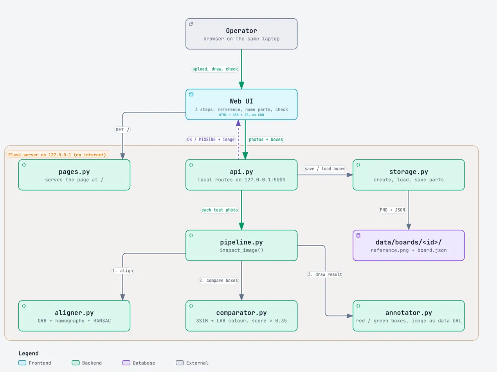

# Architecture

Made with [Archify](https://github.com/tt-a1i/archify). The interactive version
is `docs/architecture/architecture.html` (opens offline in a browser), and the
source it was generated from is `docs/architecture/architecture.archify.json`.

## How it fits together

Everything runs on one laptop. The browser talks only to Flask on `127.0.0.1`.

- **Web UI**: one page with 3 steps (reference, name parts, check). Plain HTML,
  CSS and JS, no CDN, so it works with WiFi off.
- **pages.py / api.py**: Flask routes. `pages.py` serves the page, `api.py`
  takes uploads and boxes and returns results as JSON.
- **storage.py**: saves each board as `reference.png` + `board.json` in
  `data/boards/<id>/`. Test photos are never saved.
- **pipeline.py**: runs the check for one photo in three steps:
  1. `aligner.py` lines the photo up with the reference (ORB + homography + RANSAC)
  2. `comparator.py` scores each named box (SSIM + LAB colour), missing if above 0.35
  3. `annotator.py` draws red and green boxes and turns the image into a data URL

The `core/` folder has no Flask code in it, so I can test the logic from the
terminal (`tools/run_samples.py`) without opening a browser.

## Trade-offs

| I chose | I gave up | Why |
|---|---|---|
| Compare against one reference photo | Handling big camera or angle changes | The brief says the camera is fixed and the reviewers name parts live on a new board. This works on any board with no training. |
| OpenCV + SSIM, no deep learning | Possibly higher accuracy on hard cases | Runs on any laptop CPU, installs fast, works offline, and every result has a score I can explain. |
| One fixed threshold (0.35) | Tuning per board | I picked it from measured scores. It worked on both of my boards without changing it. |
| Files on disk (PNG + JSON) | A real database | Nothing extra to install, and you can open the files and read them. Enough for one operator on one laptop. |
| Test photos checked in memory | A history of past checks | A line checks a lot of boards; keeping every photo isn't needed for "is something missing right now". |
| One page with 3 steps | Separate pages and more features | A shop-floor user shouldn't have to find their way around. Upload, name, check. |
| Flask dev server on 127.0.0.1 | Running on a network or multiple users | It's a local demo tool. Nothing is exposed outside the laptop. |